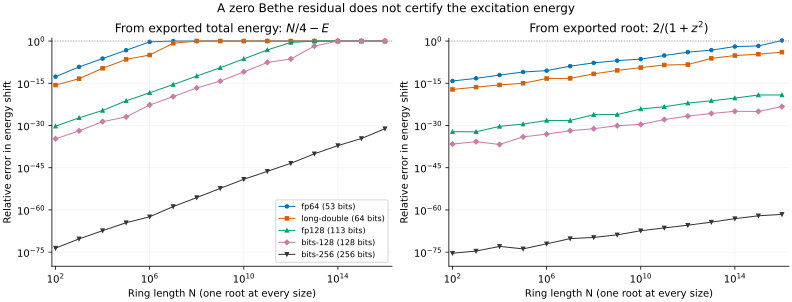

# XXX: when a converged energy is not accurate enough

<!-- BEGIN GENERATED PAGE LINK -->
[Read this page on the documentation site](https://uni20-dev.github.io/bethe/docs/tutorials/xxx-precision/)
<!-- END GENERATED PAGE LINK -->

Most of the [finite-chain tutorial](xxx.md) works well in binary64. When is
extra precision actually useful? A long-wavelength **one-magnon state** gives
a particularly clear test: the Bethe equation can have a computed residual
of zero while rounding has erased its entire energy shift.

We can check this independently against an exact dispersion. Even the enormous
ring lengths below are inexpensive: there is **one root**, not a half-filled
sea of N/2 roots. These are deliberately demanding conditioning tests, not
suggested sizes for antiferromagnetic ground-state calculations.

## 1. A small energy on top of a large reference

Use the usual periodic Hamiltonian and the fully polarized state:

```math
H=\sum_j\mathbf S_j\cdot\mathbf S_{j+1},\qquad E_{\mathrm F}=N/4.
```

One flipped spin with momentum $`p=2\pi/N`$ has

```math
E(p)=N/4-\delta_N,\qquad
\delta_N=1-\cos p=2\sin^2(\pi/N).
```

Here $`\delta_N`$ is the positive **energy lowering from the polarized state**,
not an excitation gap above the antiferromagnetic singlet. Equivalently, it
is the positive one-magnon excitation energy for the ferromagnetic Hamiltonian
$`-H`$. Its quadratic small-momentum dispersion is the familiar ferromagnetic
spin wave.

For one root, the logarithmic Bethe equation and its solution are

```math
N\arctan z=\pi I,\qquad I=N/2-1,\qquad
z=\cot(\pi/N),\qquad \delta_N=\frac{2}{1+z^2}.
```

The exported rapidity is $`z=2\lambda_{\mathrm{ABA}}`$. The integer I labels
the state; the rapidity is a continuous coordinate. As N grows, this particular
state approaches an infinite rapidity, but remains finite for every run here.

## 2. Reproduce the loss of a physical energy scale

With an [arbitrary-precision build](../building.md#enable-arbitrary-precision),
run the same state in two precisions:

```sh
bethe-xxx-pbc 1000000 --quantum-numbers 499999 --precision fp64 \
  --roots --format json > magnon-fp64.json
bethe-xxx-pbc 1000000 --quantum-numbers 499999 --precision bits-256 \
  --roots --format json > magnon-bits256.json
```

This root-only calculation needs Uni20's arbitrary-precision scalar support,
but **not MPLAPACK matrix kernels**. `bethe-info` reports the capabilities of
your build. `--precision digits-100` is another valid request; it selects
333 significand bits. It is not an output-format setting.

At this size, the true energy lowering is approximately
$`1.9739208802113778\times10^{-11}`$, subtracted from 250,000. In the saved
binary64 run the exported total energy is `249999.99999999997`. Subtracting
that decimal export from 250,000 gives $`3\times10^{-11}`$: about **52% relative
error in the energy lowering**, despite a computed residual of zero.
The 256-bit export retains the shift to better than 60 relative decimal digits.
Exact last digits depend on the compiler and math library.

Do the subtraction without silently rounding the export back to binary64:

```python
import json
from decimal import Decimal, localcontext

for filename in ("magnon-fp64.json", "magnon-bits256.json"):
    with open(filename) as stream:
        table = json.load(stream)["tables"]["states"]
    row = dict(zip((c["id"] for c in table["columns"]), table["rows"][0]))
    cell = row["energy"]
    # Runtime-precision cells carry both a decimal string and a precision tag.
    text = cell["value"] if isinstance(cell, dict) else cell
    with localcontext() as context:
        context.prec = 110
        shift = Decimal(table["metadata"]["Sites"])/4 - Decimal(text)
        print(filename, shift)
```

Using `float(text)` first would discard the additional information. Increasing
the number of printed digits after a binary64 solve cannot recover it either.

## 3. Better formulas and more precision solve different problems



[Download the numerical exports and provenance](data/xxx-precision.jsonl).

The left panel uses $`N/4-E`$. The right panel instead uses
$`2/(1+z^2)`$, with the root from the **same solve**. Both are evaluated in
110-digit decimal arithmetic after reading the exports, and compared with
an independent evaluation of $`2\sin^2(\pi/N)`$. Thus the curves measure the
information retained by the solver and its decimal export, not an accidental
binary64 conversion in the plotting script. Only the final error coordinates
are converted to ordinary plotting numbers.

The saved `long-double` runs use x86 **80-bit extended precision**, with 64
significand bits. `fp128` has 113 significand bits; `bits-128` has 128. On other
platforms, `long-double` may mean something different—check `bethe-info`.

**Subtracting extensive energies loses digits.** The total energy scales as
N while this shift scales as $`N^{-2}`$. The ratio of scales is approximately
$`N^3/(8\pi^2)`$, so subtracting the total energies loses roughly three extra
decimal digits for each factor of ten in N. At $`N=10^{12}`$, even the binary128
export has about 32% relative error in the shift. At $`N=10^{16}`$, binary128
and `bits-128` lose it completely; `bits-256` still resolves it with relative
error below $`10^{-30}`$.

**A stable expression avoids that subtraction, but cannot repair a bad root.**
The right panel is much better. However, the solver forms an angle close to
$`\pi/2`$, where the tangent is sensitive to rounding. An angle error of order
machine epsilon becomes a relative root error of order $`N\epsilon`$.
Moreover, $`\arctan z`$ becomes insensitive to z, so a tiny—or rounded-to-zero—
equation residual need not imply an accurate rapidity. Extra working precision
protects this calculation too.

For this exactly solvable **one-root** case, the best specialized formula is
simply $`2\sin^2(\pi/N)`$, evaluated directly. It needs neither a Bethe solve
nor arbitrary precision for ordinary relative accuracy! We deliberately keep
that formula as an independent check of the general solver. The lesson is
not to replace stable algorithms with more bits: use a stable observable
when available, then increase precision until the observable you need is
unchanged at your target accuracy. A stopping tolerance alone is not such
a check, and extra precision cannot remove genuine finite-size corrections.

## 4. Reproduce and validate the comparison

From the source checkout, the saved-data checks need only Python's standard
library:

```sh
python3 scripts/plot_xxx_precision_tutorial.py --check
python3 -m unittest discover -s scripts -p 'test_tutorial_xxx_precision.py'
```

With the optional [plotting environment](contributing.md#plotting-environment):

```sh
# Redraw the checked-in data, without running the solver:
python3 scripts/plot_xxx_precision_tutorial.py
# Replace the data with 75 fresh, single-root solves and redraw:
python3 scripts/plot_xxx_precision_tutorial.py --solver bethe-xxx-pbc
```

Full regeneration requires both `UNI20_ENABLE_MPREAL=ON` and
`UNI20_ENABLE_FLOAT128=ON`, so all five plotted precision choices are available.
It takes seconds, not an HPC allocation. The JSON Lines dataset keeps the
state/root rows, numerical strings and precision tags, command, compiler,
revisions and convergence metadata from each run. The independent reference
uses Python `Decimal`, Machin's formula for π and a sine series, not another
call to the Bethe solver or its transcendental-function library.
